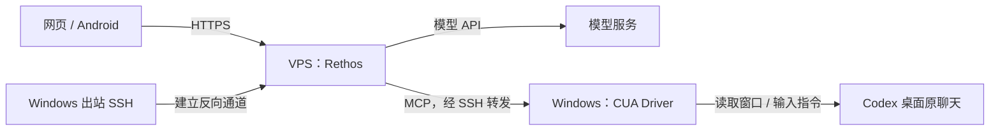

# Rethos：安装、桌面接入与更新

适用：一台 Linux VPS + 一台 Windows 10/11 x64 电脑，用网页或 Android 查看 Codex 桌面任务、讨论方案、发送“继续”。多台电脑重复桌面接入步骤即可。

**新 Windows 电脑推荐使用一键安装包。** VPS 按第 2 节准备好后，解压安装包、双击 `Install.cmd`，填写 VPS 地址、SSH 用户和电脑名称，即可配置独立 CUA、隧道与后台登录任务，并注册 MCP。具体操作及维护入口见 [一键安装说明](../deploy/desktop/README.md#新电脑一键安装)。采用一键安装时，第 3、4 节可留作手工维护参考。

这里的 **CUA Driver** 由 [Cua / trycua](https://github.com/trycua/cua) 提供，负责读取窗口、截图和键鼠输入。模型推理使用配置的 API；这套桌面连接对本机 GPU 没有额外要求。

## 1. 系统怎样工作



| 位置 | 安装什么 | 职责 |
| --- | --- | --- |
| VPS | Docker、Compose、Rethos 镜像、Caddy、OpenSSH、Python 3 | Web、模型调用、会话、定时观察、HTTPS、桌面转发 |
| Windows | Codex 桌面应用、独立 CUA Driver、OpenSSH 客户端与服务端、隧道脚本 | 运行原任务，提供桌面观察和输入 |
| 手机 | 浏览器，或 Rethos Android APK | 登录、查看报告、发送指令 |

Windows 主动连接 VPS 的 SSH 端口，建立 `VPS 127.0.0.1:22222 → Windows 127.0.0.1:22`。因此家用网络可以直接接入；当前方案使用公网 SSH，无需 Tailscale。Rethos 容器经 VPS 宿主机接入这条通道，启动 Windows 上的 MCP 客户端，再连接登录桌面中的 CUA 后台进程。

监控采用定时观察：模型读取当前界面并判断进度，按用户授权转达下一步。观察周期决定发现变化的延迟及模型调用次数。Codex 负责原任务的拆分和执行。

## 2. 安装 VPS 服务

准备域名 A 记录、22/80/443 端口，以及 [Docker Engine 与 Compose 插件](https://docs.docker.com/engine/install/)。以下命令在 VPS 普通 SSH 用户下执行；该用户需有 Docker 使用权限。

```sh
git clone https://github.com/Hopesy/Rethos.git ~/Rethos
cd ~/Rethos/deploy
cp .env.example .env
# 编辑 .env：DOMAIN=你的域名；RETHOS_IMAGE=ghcr.io/hopesy/rethos:v0.1.154
cat > docker-compose.override.yml <<'YAML'
services:
  rethos:
    extra_hosts:
      - "host.docker.internal:host-gateway"
YAML
docker compose pull
docker compose up -d --no-build
docker compose exec rethos rethos token create "Web login" --scope admin --expires 90d --out /data/rethos-admin-token
docker compose exec rethos cat /data/rethos-admin-token
```

用输出的 Token 登录 `https://你的域名`，在“设置 → AI → 自定义模型”填写服务地址、协议、密钥和模型。这里创建的 Token 有效期为 90 天；后续可在网页管理或在 VPS 创建新的 Token。

已有 Caddy/Nginx 的 VPS 使用 [现有反向代理部署方式](rethos-vps.md#vps-已有-caddy-或-nginx)，并给应用容器添加上面的 `extra_hosts`。选择一种 HTTPS 入口配置即可。

## 3. 安装 Windows CUA

**使用日常操作 Codex 的 Windows 用户**，打开管理员 PowerShell。新机器推荐官方固定安装路径，方便后续更新：

```powershell
$taskTemp = Join-Path $env:USERPROFILE '.Rethos-temp\install'
New-Item -ItemType Directory -Force $taskTemp | Out-Null
Invoke-WebRequest 'https://github.com/trycua/cua/releases/download/cua-driver-rs-v0.46.1/install.ps1' -OutFile "$taskTemp\install.ps1"
if ((Get-FileHash "$taskTemp\install.ps1" -Algorithm SHA256).Hash -ne '0DC6ED5BD97A0196D723F2D30DBCFE7C1A596C22D51FE2ECDA800DB91C02AC75') { throw '安装脚本校验失败' }
powershell.exe -NoProfile -ExecutionPolicy Bypass -File "$taskTemp\install.ps1" -Release 0.46.1 -NoConnect -NoTest
$driver = "$env:LOCALAPPDATA\Programs\Cua\cua-driver\bin\cua-driver.exe"
& $driver autostart kick
& $driver --version
& $driver status
```

安装器建立 `cua-driver-serve` 登录计划任务，后台运行于当前用户桌面。`-NoConnect` 保留现有 Codex/Claude 的 MCP 配置；`-NoTest` 跳过安装器的输入自测。记录 `$driver` 的完整路径，后面 VPS 转发会用到它。

Windows 需保持用户登录，桌面可用；休眠、锁屏和关机会影响观察与输入。原 Codex 桌面应用也应保持运行。本机的 Rethos Windows 客户端可按使用习惯选装；本方案的常驻组件是独立 CUA 与 SSH 隧道。

## 4. 首次连接电脑与 VPS

每台电脑需要设置一次。下例使用反向端口 `22222`、MCP 名称 `desktop-cua`。变量中的用户名、主机和 Windows 路径替换为自己的值。

| SSH 密钥 | 私钥放在哪里 | 公钥放在哪里 |
| --- | --- | --- |
| `rethos_vps_tunnel` | Windows 用户的 `.ssh` | VPS 用户的 `authorized_keys`，仅供反向转发 |
| `rethos_windows` | VPS 用户的 `.ssh` | Windows SSH 授权文件，供 VPS 启动 CUA MCP |
| `rethos_bridge` | Rethos 数据卷 `/data/.ssh` | VPS 用户的 `authorized_keys`，固定执行桌面转发脚本 |

三把密钥分别生成，公钥按表复制；私钥留在生成位置。无人值守密钥使用空口令，目录及文件按下列步骤设置访问权限。

<details>
<summary><strong>展开：OpenSSH、密钥与后台隧道</strong></summary>

**VPS：**准备目录和回连 Windows 的密钥。

```sh
install -d -m 700 "$HOME/.ssh" "$HOME/rethos-desktop"
ssh-keygen -t ed25519 -N '' -f "$HOME/.ssh/rethos_windows"
cat "$HOME/.ssh/rethos_windows.pub"
sudo ssh-keygen -lf /etc/ssh/ssh_host_ed25519_key.pub
```

保存最后显示的 VPS 主机指纹。**Windows 管理员 PowerShell：**安装并启动 OpenSSH。

```powershell
Add-WindowsCapability -Online -Name OpenSSH.Client~~~~0.0.1.0
Add-WindowsCapability -Online -Name OpenSSH.Server~~~~0.0.1.0
Set-Service sshd -StartupType Automatic
Start-Service sshd
```

在新机器的 `C:\ProgramData\ssh\sshd_config` 全局区域（第一个 `Match` 之前）添加 `ListenAddress 127.0.0.1`，执行 `Restart-Service sshd`。已有 SSH 服务时按其现有用途配置监听地址。

将 VPS 的 `rethos_windows.pub` 整行追加到 Windows 授权文件：管理员账户默认用 `C:\ProgramData\ssh\administrators_authorized_keys`；普通账户用 `$env:USERPROFILE\.ssh\authorized_keys`。管理员授权文件的权限设置为：

```powershell
icacls C:\ProgramData\ssh\administrators_authorized_keys /inheritance:r /grant:r '*S-1-5-18:(F)' '*S-1-5-32-544:(F)'
```

普通账户的 `.ssh` 与授权文件由该账户拥有，并仅授予该账户、SYSTEM 和 Administrators 访问。随后在 Windows 生成出站密钥，首次连接时对照刚才的 VPS 指纹：

```powershell
$vpsHost = 'VPS公网地址'
$vpsUser = 'VPS用户名'
New-Item -ItemType Directory -Force "$env:USERPROFILE\.ssh" | Out-Null
ssh-keygen -t ed25519 -f "$env:USERPROFILE\.ssh\rethos_vps_tunnel"
Get-Content "$env:USERPROFILE\.ssh\rethos_vps_tunnel.pub"
ssh "${vpsUser}@${vpsHost}"
# 退出 VPS shell 回到本机后，复制本机 SSH 主机公钥：
scp C:\ProgramData\ssh\ssh_host_ed25519_key.pub "${vpsUser}@${vpsHost}:rethos-desktop/windows-host.pub"
```

**VPS：**将 Windows 出站公钥填入以下位置。

```sh
printf '%s\n' 'restrict,port-forwarding,permitlisten="127.0.0.1:22222" ssh-ed25519 替换为Windows出站公钥及备注' >> "$HOME/.ssh/authorized_keys"
chmod 600 "$HOME/.ssh/authorized_keys"
```

**Windows：**复制本仓库的 [`Start-RethosTunnel.ps1`](../deploy/desktop/Start-RethosTunnel.ps1) 和 [`BackgroundLauncher.cs`](../deploy/desktop/BackgroundLauncher.cs) 到 `$env:USERPROFILE\RethosDesktop`。在当前用户的管理员 PowerShell 编译后台启动器并注册登录任务：

```powershell
$localDir = Join-Path $env:USERPROFILE 'RethosDesktop'
# 将 Start-RethosTunnel.ps1 和 BackgroundLauncher.cs 保存到上述目录后执行
& "$env:WINDIR\Microsoft.NET\Framework64\v4.0.30319\csc.exe" /nologo /target:winexe /platform:x64 /optimize+ "/out:$localDir\BackgroundLauncher.exe" "$localDir\BackgroundLauncher.cs"
if ($LASTEXITCODE -ne 0) { throw '后台启动器编译失败' }
$powershellExe = "$env:WINDIR\System32\WindowsPowerShell\v1.0\powershell.exe"
$taskArgs = '"{0}" -NoProfile -NonInteractive -ExecutionPolicy Bypass -File "{1}\Start-RethosTunnel.ps1" -VpsHost "{2}" -VpsUser "{3}"' -f $powershellExe,$localDir,$vpsHost,$vpsUser
$action = New-ScheduledTaskAction -Execute "$localDir\BackgroundLauncher.exe" -Argument $taskArgs -WorkingDirectory $localDir
$user = [Security.Principal.WindowsIdentity]::GetCurrent().Name
$trigger = New-ScheduledTaskTrigger -AtLogOn -User $user
$principal = New-ScheduledTaskPrincipal -UserId $user -LogonType Interactive -RunLevel Limited
$settings = New-ScheduledTaskSettingsSet -MultipleInstances IgnoreNew -ExecutionTimeLimit ([TimeSpan]::Zero) -AllowStartIfOnBatteries -DontStopIfGoingOnBatteries
Register-ScheduledTask -TaskName 'Rethos-Desktop-Tunnel' -Action $action -Trigger $trigger -Principal $principal -Settings $settings
Start-ScheduledTask -TaskName 'Rethos-Desktop-Tunnel'
```

启动器以无控制台方式创建 PowerShell，避免 Windows Terminal 在登录时弹出黑窗口；停止任务会同时结束所属 SSH 子进程。隧道断线后自动重连，日志位于 `%LOCALAPPDATA%\Rethos\logs\desktop-tunnel.log`。VPS 的 SSH 服务需允许该用户做 TCP 远程转发；监听地址保持 `127.0.0.1`。

</details>

<details>
<summary><strong>展开：VPS 转发脚本与 Rethos MCP</strong></summary>

以下在 **VPS** 执行。填写 Windows 的 SSH 用户名及第 3 步得到的 CUA 完整路径。

```sh
desktop="$HOME/rethos-desktop"
win_user='Windows用户名'
win_driver='C:\Users\Windows用户名\AppData\Local\Programs\Cua\cua-driver\bin\cua-driver.exe'
awk '{print "rethos-windows "$1" "$2}' "$desktop/windows-host.pub" > "$desktop/known_hosts"
cat > "$desktop/ssh_config" <<EOF
Host desktop-windows
    HostName 127.0.0.1
    Port 22222
    User $win_user
    IdentityFile $HOME/.ssh/rethos_windows
    HostKeyAlias rethos-windows
    UserKnownHostsFile $desktop/known_hosts
    StrictHostKeyChecking yes
    BatchMode yes
    ConnectTimeout 10
    ServerAliveInterval 15
    ServerAliveCountMax 3
    ControlMaster auto
    ControlPersist 600
    ControlPath $desktop/control-%C
EOF
chmod 600 "$desktop/ssh_config" "$desktop/known_hosts"
python3 - "$desktop" "$win_driver" <<'PY'
import base64, pathlib, shlex, sys
root = pathlib.Path(sys.argv[1])
driver = sys.argv[2].replace("'", "''")
ps = "[Console]::OutputEncoding=[Text.Encoding]::UTF8; $OutputEncoding=[Text.Encoding]::UTF8; $ProgressPreference='SilentlyContinue'; & '" + driver + r"' mcp --socket '\\.\pipe\cua-driver'; exit $LASTEXITCODE"
encoded = base64.b64encode(ps.encode('utf-16le')).decode()
target = root / 'cua-driver-desktop'
target.write_text('#!/bin/sh\nexec /usr/bin/ssh -T -F ' + shlex.quote(str(root / 'ssh_config')) + ' desktop-windows powershell.exe -NoProfile -NonInteractive -EncodedCommand ' + encoded + '\n')
target.chmod(0o700)
PY
```

继续在 Compose 目录准备 **容器 → VPS** 的受限入口。数据卷内的文件由容器应用用户创建，保留正确所有权。

```sh
cd ~/Rethos/deploy
docker compose exec -T rethos sh -c 'umask 077; mkdir -p /data/.ssh; ssh-keygen -q -t ed25519 -N "" -f /data/.ssh/rethos_bridge'
bridge_pub=$(docker compose exec -T rethos cat /data/.ssh/rethos_bridge.pub)
printf 'restrict,command="%s/cua-driver-desktop" %s\n' "$desktop" "$bridge_pub" >> "$HOME/.ssh/authorized_keys"
cat <<EOF | docker compose exec -T rethos sh -c 'cat > /data/.ssh/config; chmod 600 /data/.ssh/config'
Host rethos-desktop
    HostName host.docker.internal
    Port 22
    User $USER
    IdentityFile /data/.ssh/rethos_bridge
    HostKeyAlias rethos-vps
    UserKnownHostsFile /data/.ssh/known_hosts
    StrictHostKeyChecking yes
    BatchMode yes
    ConnectTimeout 10
    ServerAliveInterval 20
    ServerAliveCountMax 3
EOF
awk '{print "rethos-vps "$1" "$2}' /etc/ssh/ssh_host_ed25519_key.pub | docker compose exec -T rethos sh -c 'cat > /data/.ssh/known_hosts; chmod 600 /data/.ssh/known_hosts'
```

在 Rethos 的 MCP 设置中添加：

| 字段 | 值 |
| --- | --- |
| 名称 | `desktop-cua` |
| 连接类型 | 本地命令 / stdio |
| 命令 | `ssh` |
| 参数 | `-T`、`-F`、`/data/.ssh/config`、`rethos-desktop`（依次四个参数） |
| 启用 | 开启，并在目标机器人的工具选择中启用该 MCP |

VPS 的“Works on / 电脑”开关按 VPS 桌面功能设置，本机桌面通过上述自定义 MCP 接入。首次使用可让 Rethos 列出窗口并报告目标聊天的最新内容。

</details>

添加第二台电脑时，为它另建密钥、转发脚本和 MCP 名称，并使用独立的反向端口，例如 `22223`。Windows 隧道脚本支持 `-ReversePort 22223`；VPS 公钥的 `permitlisten` 与该电脑的 `ssh_config` 端口同步修改。

## 5. 日常怎么用

给机器人的说明可以写为：

> 通过 desktop-cua 查看和操作我 Windows 上的 Codex 桌面原聊天。使用中文。每轮先读取最新界面，确认聊天标题和输入框，再按我的授权发送指令；发送后核对消息是否送达。任务拆分与执行由 Codex 完成。遇到问题、审批或需要决策时，在当前 Rethos 聊天汇报并等待我的回答。为发送记录唯一标记，重试前先核对回执。持续监控使用内置定时任务，写明目标、周期、授权范围和结束条件，完成后暂停。

可直接发送：

- `查看 Codex 桌面“项目开发”聊天的当前进度。`
- `向这个聊天发送一次“继续”，然后确认已经送达。`
- `先和我讨论下一步，确认后将方案发给这个桌面聊天。`
- `每 5 分钟观察一次，完成、失败、提问或等待审批时提醒我；完成后暂停。`

手机使用同一 HTTPS 地址；在已登录网页“设置 → 通用 → 手机扫码登录”生成二维码。Android APK 的服务器地址可在右上角菜单更换，使用 Token 登录。下载与覆盖安装见 [Android 文档](../android/README.md)。

当前提醒通过 Rethos 聊天、收件箱及在线网页呈现；手机后台锁屏推送仍列在后续待办中。

## 6. 后续更新与回退

| 更新对象 | 如何更新 | 会影响哪里 |
| --- | --- | --- |
| VPS Rethos | 拉取新镜像，重建容器 | Web、模型执行与服务端；Android 页面随之更新 |
| 独立 CUA | 更新 Windows CUA，重新启动 `cua-driver-serve` | 本机桌面读取与操作 |
| SSH 隧道 | 替换 `Start-RethosTunnel.ps1`，停止并重新启动同名计划任务 | 本机与 VPS 的连接 |
| Rethos Windows 客户端 | 客户端更新或安装新版 EXE | 该客户端及其内置 CUA |
| Android 原生外壳 | 用同签名新版 APK 覆盖安装 | 菜单、文件选择等原生功能 |

**VPS：**等当前任务空闲，先备份旧配置，编辑 `.env` 的镜像版本并拉取，再停服备份数据、切换镜像。

```sh
cd ~/Rethos/deploy
umask 077
backup="$HOME/rethos-backups/$(date -u +%Y%m%d-%H%M%S)"
mkdir -p "$backup"
cp .env docker-compose.yml docker-compose.override.yml "$backup/"
# 编辑 .env 中的 RETHOS_IMAGE，填入新发布的标签或摘要
docker compose pull
docker compose stop
docker run --rm -v rethos_data:/source:ro -v "$backup:/backup" alpine:3.22 sh -c 'tar czf /backup/data.tgz -C /source . && chmod 600 /backup/data.tgz'
docker compose up -d --no-build --force-recreate
docker compose ps
```

自定义卷名时替换 `rethos_data`。回退时恢复该备份中的 `.env` 并重建容器；涉及数据迁移时同时恢复对应的数据备份。完整恢复及已有代理的维护见 [VPS 文档](rethos-vps.md)。

**独立 CUA：**在 Windows 管理员 PowerShell，用官方安装器指定需要的版本：

```powershell
& $driver check-update --json
Invoke-WebRequest 'https://cua.ai/driver/install.ps1' -OutFile "$taskTemp\install.ps1"
powershell.exe -NoProfile -ExecutionPolicy Bypass -File "$taskTemp\install.ps1" -Release '目标版本号' -NoConnect -NoTest
& $driver autostart kick
& $driver --version
& $driver status
```

此处 `$driver` 和 `$taskTemp` 使用第 3 步的值。官方安装的固定入口会跟随版本切换。若手工解压到 `cua-driver-版本号` 目录，更新时需同步计划任务的 EXE 路径，以及 VPS 转发脚本中的 `win_driver`；用第 4 步 Python 命令重新生成转发脚本。保留旧目录和升级前任务 XML，以便恢复。已有 MCP 会话在下一次重新连接时使用新客户端；需要立即刷新时，在 Rethos 空闲期间依次执行 `docker compose restart rethos`、`docker compose restart caddy`。

**停用：**Windows 停止并禁用 `Rethos-Desktop-Tunnel`，执行 `cua-driver autostart disable`、`cua-driver stop`；VPS 执行 `docker compose down` 保留数据卷。完全卸载时再按实际使用情况清理独立安装目录、三把密钥与授权条目。

## 7. 常见问题与当前基线

| 现象 | 先查看 |
| --- | --- |
| 桌面离线 | Windows 是否登录、CUA `status`、隧道日志 |
| SSH 连接失败 | VPS `127.0.0.1:22222` 是否监听、双方公钥与主机指纹、Windows 管理员授权文件位置 |
| 容器调用失败 | `extra_hosts`、VPS 防火墙是否允许 Docker 网段访问 SSH、`/data/.ssh` 所有权 |
| 模型说看不到桌面 | 该机器人的 `desktop-cua` 是否启用、MCP 启动错误、目标窗口是否存在 |
| 升级后仍显示旧版 | 运行中进程、登录计划任务和 VPS 调用路径是否指向同一版本 |

2026-11-10 当前部署：VPS **Rethos 0.1.154**；本机独立 **CUA Driver 0.46.1**；Android **0.1.0**。Rethos Windows 包内置的 CUA 随安装包维护，0.1.154 内置版本为 **0.41.3**。这些组件分别更新。

当前电脑沿用手工安装路径 `C:\Users\zhouh\agent\cua-driver-0.46.1\cua-driver.exe`；计划任务和 VPS `/home/zhouhl/rethos-desktop/cua-driver-desktop` 已同步。新机器按本文采用官方固定安装入口。当前机器的升级记录、备份路径见 [部署维护记录](rethos-vps.md#当前部署记录)。
