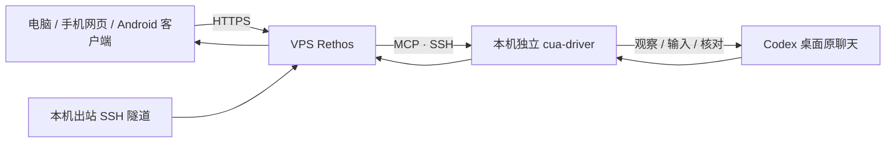

# Rethos VPS 部署与维护

当前使用方式是：电脑或手机浏览器、Android 客户端访问 Rethos，讨论任务、查看 Codex 桌面进度，随后由 Rethos 经本机 CUA 向选定聊天发送指令。飞书接入已经取消。



本机主动连接 VPS 的公网 SSH，VPS 的反向端口只监听回环地址。当前链路使用独立 SSH 密钥，VPS 上的 Tailscale 已卸载。本机保留 CUA 和 SSH 连接组件。

## 镜像与模块

| 组件 | 作用 | 部署位置 |
| --- | --- | --- |
| `ghcr.io/hopesy/rethos` | Web、模型会话、工具、MCP 和调度 | VPS Docker |
| Caddy | HTTPS、网页和流式消息转发 | VPS |
| 独立 `cua-driver` | 读取并操作当前 Codex 桌面应用 | Windows 本机 |
| 反向 SSH 通道 | 本机主动连接 VPS，使 VPS 可调用本机 CUA | Windows → VPS |
| 数据卷 `/data` | 配置、会话、模型凭据和浏览器会话 | VPS 持久化卷 |

镜像内置 Claude Code、Codex CLI 与浏览器，用于 VPS 的模型执行和网页工具。桌面原会话的监控与发送经本机 CUA 完成。

镜像支持 AMD64 和 ARM64。`latest` 跟随 main 的成功构建；`sha-<完整提交号>` 标记对应源码；`@sha256:<摘要>` 可固定具体镜像内容。版本标签触发时另发布 `v*` 标签。

## 首次部署：域名与自动 HTTPS

准备 Docker Engine 和 Compose 插件，将域名 A/AAAA 指向 VPS，开放 80、443。镜像发布在 GHCR。

```sh
git clone https://github.com/Hopesy/Rethos.git Rethos
cd Rethos/deploy
cp .env.example .env
```

编辑 `.env`：

```dotenv
DOMAIN=rethos.example.com
COMPOSE_PROJECT_NAME=rethos
RETHOS_IMAGE=ghcr.io/hopesy/rethos:latest
```

启动并创建登录 Token：

```sh
docker compose pull
docker compose up -d --no-build
docker compose ps
docker compose exec rethos rethos token create "Web login" --scope admin --expires 90d --out /data/rethos-admin-token
docker compose exec rethos cat /data/rethos-admin-token
```

打开 HTTPS 网页，粘贴上述 Token 登录。后续浏览器使用同一个 Token，登录后在 **设置 → 通用 → 访问 Token → 管理** 管理 Token。Token 文件权限为仅所属用户可读写，请将其内容保存在密码管理器中。

手机打开相机，扫描电脑网页 **设置 → 通用 → 手机扫码登录** 中的二维码，确认服务器并点“登录”。添加到主屏幕后可使用 Web 应用。账号和模型在页面配置，也可使用 `docker compose exec rethos rethos setup`。Codex 登录可运行 `docker compose exec rethos codex login --device-auth`。

两个容器共享网络命名空间；应用在容器回环地址监听，Caddy 对外提供经过配对认证的入口。持久化卷默认名为 `rethos_data`；内部数据路径沿用 `/data/.openmausbot`，配置环境变量继续兼容 `OMB_*`。

## VPS 已有 Caddy 或 Nginx

使用仓库根目录的 `compose.yaml`，把入口绑定在主机回环地址。已有代理负责域名和证书。例如：

```dotenv
COMPOSE_PROJECT_NAME=rethos
RETHOS_IMAGE=ghcr.io/hopesy/rethos:latest
OMB_BIND_ADDRESS=127.0.0.1
OMB_HTTP_PORT=8790
OMB_PUBLIC_URL=https://rethos.example.com
OMB_HTTPS_HOST=rethos.example.com
```

在仓库根目录执行 `docker compose pull && docker compose up -d --no-build`。主机 Caddy 配置：

```caddyfile
rethos.example.com {
    reverse_proxy 127.0.0.1:8790 {
        flush_interval -1
    }
}
```

保留 Host 和代理协议头；同机入口用于两层代理之间的连接。`OMB_HTTPS_HOST` 和 `OMB_PUBLIC_URL` 使用同一域名。

## 更新、备份、回退

在当前 Compose 目录运行。先记录已运行镜像。若 `.env` 使用固定摘要，升级前将 `RETHOS_IMAGE` 改成新摘要；希望跟随最近成功发布时改为 `ghcr.io/hopesy/rethos:latest`。固定摘要每次拉取都对应同一版本。

```sh
docker inspect --format '{{.Image}}' "$(docker compose ps -q rethos)"
docker compose images
mkdir -p backups
docker compose stop
docker run --rm -v rethos_data:/source:ro -v "$PWD/backups:/backup" alpine:3.22 \
  sh -c 'tar czf /backup/rethos-data-$(date -u +%Y%m%d-%H%M%S).tgz -C /source .'
docker compose pull
docker compose up -d --no-build --force-recreate
docker compose ps
docker compose logs --tail 80 rethos
```

自定义 `OMB_DATA_VOLUME` 时将示例中的 `rethos_data` 替换为实际卷名。备份含配置和凭据，应限制文件访问。

回退时将 `.env` 的 `RETHOS_IMAGE` 改为上一版固定标签或摘要，再执行 `docker compose pull` 和 `docker compose up -d --no-build --force-recreate`。数据格式发生迁移时同时恢复升级前的卷备份。

停用：`docker compose down`，保留数据卷。完全删除数据时，先确认备份，再显式移除对应卷。

## 维护发布

修改源码后提交并推送 main。GitHub Actions 在原生 x86/ARM runner 上构建相同来源，分别验证启动、OSS 品牌、DuckDB、浏览器、CLI、HTTPS 配对、同源检查、事件流、重建后的数据和登录状态，再合并发布镜像清单。

本次仓库的 `push` 触发未产生运行记录，已使用下列手动入口成功发布。更新时检查 Actions 确实出现新提交对应的运行；需要时执行：

```sh
gh workflow run docker.yml --repo Hopesy/Rethos --ref main
gh run list --repo Hopesy/Rethos --workflow docker.yml --limit 5
docker buildx imagetools inspect ghcr.io/hopesy/rethos:latest
```

镜像内带 LICENSE、NOTICE 和第三方归属信息。测试只使用专门创建的容器和临时数据卷。首次 GitHub Packages 发布后需确认包可见性和匿名拉取能力；成功发布的摘要显示在工作流 Summary 中。

## 日常使用

1. 打开你的 Rethos HTTPS 地址，用已保存的访问 Token 登录。首次接入或丢失 Token 时，在 VPS 使用 `rethos token create` 命令创建管理员 Token，步骤见上文。手机使用已登录网页生成的二维码登录。
2. Windows 用户保持登录，独立 CUA 和 `Rethos-Desktop-Tunnel` 计划任务保持运行，Codex 桌面打开目标聊天。休眠、关机或锁定桌面时，观察和输入会受影响。
3. 在 Rethos 聊天中指定桌面聊天标题。首次绑定时让 Rethos 回报实际标题与最后一条回复，确认目标后再发送操作指令。
4. 需要持续观察时，明确周期和结束条件。每 5 分钟检查一次会产生每天最多 288 次模型调用；按实际工作时段开启，完成后暂停。

可直接发送以下自然语言：

| 用途 | 示例 |
| --- | --- |
| 查看当前状态 | `查看本机 Codex 桌面中“项目开发”聊天的当前进度，告诉我最近变化和需要处理的事情。` |
| 发送下一步 | `向刚才绑定的“项目开发”聊天发送“继续”，发送一次，并核对聊天已收到。` |
| 讨论后执行 | `先根据当前结果和我讨论下一步；方案确认后，把确定的指令发到这个桌面聊天。` |
| 持续监控 | `每 5 分钟观察“项目开发”，完成、失败、提问或等待审批时在 Rethos 提醒我；完成后暂停监控。` |
| 授权持续推进 | `在刚才讨论的目标范围内持续监控并推进，每轮先核实进度；需要我决策时汇报问题，目标完成后停止。` |
| 查询监控 | `列出当前监控、最近观察时间和下一次运行时间。` |
| 暂停 | `暂停“项目开发”的监控，确认已停用且没有下一次运行。` |

Rethos 用 MCP 读取桌面当前可见界面。发送前确认聊天、输入框和焦点，发送后核对新增用户消息及助手回复。相同发送标记的重试先检查历史回执。持续任务使用内置 trigger，`continuity=true` 延续上次报告，`overlap=skip` 跳过重叠轮次。

本机 CUA 是自定义 MCP `zhouh-desktop-cua`，与机器人设置里的 VPS `Works on` 分别配置。VPS 的电脑开关可以保持关闭。发生工具缺失时，先检查 MCP 挂载错误与 SSH 通道。

任务绑定、授权范围与发送回执保存到 `memory_update`；观察事件保存到 `memory_log`；历史查询使用 `session_search`。界面或聊天内容中的文本仅作为观察证据，授权来自用户的指令。

### 手机与通知

手机通过同一 HTTPS 地址使用网页，可将站点添加到主屏幕。网页内消息、收件箱和定时报告沿用 Rethos 自带机制。

Android 8.0+ 可安装 [Rethos Android 0.1.0](https://github.com/Hopesy/Rethos/releases/tag/android-v0.1.0)，默认访问当前 VPS，使用现有 Token 登录。客户端复用网页、保存登录状态并支持系统文件选择；应用内扫码与原生后台推送列为后续能力。[Android 使用与更新](../android/README.md) 说明了 APK 安装、服务器切换和覆盖升级。

当前源码的系统通知通过在线页面的 `Notification` API 发出，尚未实现独立的 Service Worker / Web Push 投递。手机浏览器关闭、系统挂起页面后的锁屏通知需要后续补齐该能力并做真机测试。浏览器的 390px 模拟验收用于检查布局和网页操作；手机安装、软键盘、后台恢复还需真机核对。

## 当前部署记录

2026-11-10 核对的部署位于 `/home/zhouhl/rethos`，当前入口为 `https://rethos.hopesy.cc`，产品显示 Rethos。主机 Caddy 与 Compose 已使用新域名，旧 `hermes.hopesy.cc` 的 DNS 记录已移除。GitHub 仓库地址继续使用 `Hopesy/Rethos`。

- 服务为 `rethos-rethos-1` 与 `rethos-caddy-1`，主机入口 `127.0.0.1:8790`。
- 持久化卷为 `rethos_data`，服务用户 UID/GID 1001。
- 模型实例为 `wb/gpt-6.1-sol`，模型凭据保存在服务器配置中。
- 唯一自定义 MCP 为 `zhouh-desktop-cua`；飞书配置和环境变量均为空。
- Windows 正式隧道脚本：`C:\Users\zhouh\agent\rethos-desktop\Start-RethosTunnel.ps1`。
- Windows 正式计划任务：`Rethos-Desktop-Tunnel`；CUA 已有任务为 `cua-driver-serve`。
- VPS 桌面转发入口：`/home/zhouhl/rethos-desktop/cua-driver-desktop`。
- SSH 配置启用了连接复用；新 MCP 会话可以复用已验证的桌面 SSH 连接。
- 自定义 MCP 启动等待调整为 30 秒，适应跨 SSH 的初始化；内置工具维持 8 秒。
- 已部署版本 `0.1.154`，源码提交 `7e08e5f5fb932626872a1600d11613cd289de6b6`；镜像摘要 `sha256:e0a8aa41a3c9f96a442840f00f30f70deaaeb7f8357c9ba2d9e2470356a00439`。
- 发布记录：[0.1.154 镜像构建与验收](https://github.com/Hopesy/Rethos/actions/runs/42781685617)。`v0.1.154`、源码标签与 `latest` 的多架构摘要一致。
- 正式机器人说明与工具选择保存在 `/home/zhouhl/rethos/production-desktop-monitor.md`、`desktop-team.yaml`，已通过 `rethos team apply` 写入持久化配置。
- Hermes 迁移备份：`/home/zhouhl/rethos-backups/hermes-before-rethos-20261108-115245/`。
- 首次 Rethos 升级备份：`/home/zhouhl/rethos-backups/rethos-before-update-20261108-162452/`。
- 设置说明更新前备份：`/home/zhouhl/rethos-backups/rethos-before-copy-cleanup-20261109-034324/`，含数据卷、Compose 与原镜像配置。
- 帮助提示与 AI 配置修复前备份：`/home/zhouhl/rethos-backups/rethos-before-settings-refinement-20261109-053155/`。
- Token 登录升级前备份：`/home/zhouhl/rethos-backups/rethos-before-0.1.151-20261109-164814/`，含数据卷、Compose、环境配置与上一版镜像记录。
- 0.1.152 升级前备份：`/home/zhouhl/rethos-backups/rethos-before-0.1.152-20261110-072309/`，含数据卷、Compose、环境配置与上一版镜像记录。
- 0.1.154 升级前备份：`/home/zhouhl/rethos-backups/rethos-before-0.1.154-20261110-083035/`，含数据卷、Compose、环境配置与上一版镜像记录，压缩包完整性已验证。

2026-11-10 北京时间 16:31 完成 0.1.154 部署。首次检查发现 Nimbus 忙碌，等待任务结束后才停止服务、备份并切换镜像。公网版本、Token 鉴权、模型与桌面 MCP 配置保留、反向 SSH 端口均已核对。登录页使用黑色按钮，移除重复图标与浮动阴影；简体中文下新建机器人的问候、引导选项和配置提示使用中文，默认名称保持原样。配置语言为中文及跟随浏览器中文两条流程均通过隔离 HTTP 服务验证。过程证据位于 `.Rethos-temp/login-flat/`。

2026-11-10 北京时间 15:23 完成 0.1.152 部署。容器健康检查与公网 HTTPS 验证通过；原管理员 Token、模型配置与自定义桌面 MCP 保留。线上资源包含 Anthropic 协议、模型连接测试、指向本仓库 APK 的 Android 下载入口；机器人提示词已按独立 MCP 获取桌面实时观察。部署与只读验收证据位于 `.Rethos-temp/release-0.1.152/`。

保留上述备份的受限权限。备份包含凭据和历史数据。已有 `wb.hopesy.cc` 模型服务继续独立运行。

### 2026-11-10：Token 登录与手机扫码

北京时间 00:48 完成 0.1.151 镜像切换。升级前确认机器人空闲，保存配置和旧镜像记录，停止服务后备份完整数据卷，再重建容器并等待健康检查通过。`.env` 固定本次镜像摘要。

公网 HTTPS 返回版本 `0.1.151`，管理员 Token 鉴权、登录页和 JavaScript 资源读取通过。实际浏览器确认页面仅显示 Token 输入与登录操作，已移除临时配对入口、获取 Token 帮助和输入框上方标签。新浏览器使用同一 Token；手机在已登录网页的“设置 → 通用 → 手机扫码登录”获取二维码。多浏览器登录、二维码兑换及撤销在隔离服务验证，证据见 [Token 登录验收](verification/token-login.md)。

### 2026-11-09：设置说明与后台连接

设置页保持上游的菜单、分组、功能入口和显示条件，仅精简 32 条中文说明。类型检查、前端构建及 54 项语言、设置分组和配对回归通过；隔离浏览器验收覆盖桌面与 390px 尺寸，发布后已在正式网页确认新文案。

Windows 隧道改用无窗口 SSH 子进程，连接输出保存在 `%LOCALAPPDATA%\Rethos\logs\desktop-tunnel.log`。断线重试间隔为 10、20、40、60 秒，持续连接一分钟后恢复初始间隔。已验证受控断线后 10 秒自动重连、VPS 经新连接访问本机以及生产镜像更新后的回连。日志轮转和启动方式见 [桌面连接说明](../deploy/desktop/README.md)。

### 电脑页帮助与自有模型配置

电脑页保留原有功能分组。使用说明放在标题旁的问号中：鼠标悬停、键盘聚焦或手机点击即可查看，Esc 或点击外部关闭。路径、Cua Driver 版本与镜像摘要在“安全与存储 → 技术详情”中展开。运行状态、错误和操作结果继续直接展示。

自定义模型通过“设置 → AI → 自定义模型”管理地址、协议、密钥和模型列表，支持 Chat Completions、Responses、Anthropic。点击拉取图标读取模型，也可手动输入模型 ID；左侧测试图标使用当前默认模型验证连接并显示耗时。已有连接的密钥留空时保留原值；旧 Claude Code 连接也在同一区域管理。详细步骤见 [自定义模型配置](custom-engines.md)。

兼容迁移时使用的 `wb` 实例 ID，服务器按实际服务配置返回展示信息，保留机器人、会话和默认模型的引用。服务默认模型是该服务的回退值，已有机器人的模型选择继续沿用各自设置。密钥只接收写入，配置响应仅包含是否已保存。服务正被任务使用时，保存等待该任务完成后重试。

隔离验收使用本地模拟模型服务，覆盖保存后重新打开、模型刷新、密钥保留、旧实例 ID、忙碌保护及非法地址。浏览器验收覆盖悬停、Esc、触屏点击和 390px 下的帮助提示与编辑表单，过程证据位于 `.Rethos-temp/settings-refinement/`。

2026-11-09 北京时间 13:32 已部署到 VPS。AMD64/ARM64 镜像构建与容器验收全部通过，服务健康检查及 doctor 均通过。正式网页确认 `wb` 显示 `https://wb.hopesy.cc/v1`、`gpt-6.1-sol` 和 10 个模型；“管理”与“API 密钥”中的编辑入口均加载同一项配置。生产仅做读取和打开编辑界面的验收。备份与当前文件对比确认模型配置、默认模型选择、自定义桌面 MCP 配置逐项相同。

## 本次迁移与验收

以下沿用桌面监控方案的顺序，实施时补充证据和结果。

- [x] 发布 Rethos 镜像，核对 AMD64/ARM64、摘要和匿名拉取。
- [x] 备份 VPS 上 Hermes 的配置、数据、服务定义和相关 Caddy 配置。
- [x] 卸载 VPS 的 Hermes 与 Tailscale，验证公网 SSH。
- [x] 部署 Rethos HTTPS，完成浏览器配对与模型配置。
- [x] 本机反向 SSH 建连、断开后自动重连和用户登录计划任务。
- [x] 自定义 MCP 接入本机 CUA：列出工具、读取窗口和画面。
- [x] 绑定专用 Codex 桌面验收会话，查询实际进度。
- [x] 网页向该会话发送首条消息与“继续”，原桌面分别返回两个独立验收标记。
- [x] 运行中追加要求：Codex 思考时追加文本出现在原聊天，最终同一回合返回 `RETHOS_RUNNING_BASE_OK RETHOS_RUNNING_APPEND_OK`。
- [x] 定时观察在北京时间 00:39、00:44 两轮读取成功，连续两轮后自动暂停并清空下一次运行时间。
- [x] 发送回执去重：重复请求复用第二阶段回执，Codex 原聊天没有新增消息。
- [x] 两轮定时观察之间重建容器，监控继续运行；浏览器登录和聊天数据保留。
- [x] 390px 手机布局模拟、输入发送和结果回显。
- [x] Codex 原生提问 → Rethos 选择题 → 手机尺寸网页选择“仅观察本次” → CUA 提交原问题卡片；Codex 回复 `RETHOS_ANSWER_OK 仅观察本次`。
- [ ] 原生权限审批、执行失败、断网/锁屏状态的完整交互验收。
- [x] Android Kotlin + WebView 客户端、签名 APK 和 GitHub Actions 发布。
- [x] Android 15 模拟器验证状态保留、返回、文件选择回传、连接错误与重试；正式包中文登录页与软键盘布局检查。
- [ ] 手机真机安装、软键盘、后台恢复。
- [ ] 独立 Web Push 与手机后台锁屏通知。

每次发送使用明确选定的验收会话，记录发送前后的状态。临时脚本与证据放 `.Rethos-temp/`。生产配置及密钥留在受限目录。

本轮回归：类型检查、OSS 检查、修改文件 lint 通过；配对/环境/更新相关 30 项测试通过；MCP 工具测试 114 项通过。镜像两个架构的容器验收通过。验收数据位于独立 `rethos-acceptance` Docker 项目；正式 Rethos 保留用户配置和日常入口。

## Windows 安装包与 VPS 镜像

Windows 安装包通过 [Rethos Windows installer](https://github.com/Hopesy/Rethos/actions/workflows/package-win.yml) 构建、安装验收并发布。下载、更新、卸载和发布步骤见 [安装包发布文档](releasing.md)。桌面安装包与 VPS Docker 镜像分别发布；当前 VPS 的网页入口及 CUA 通道继续按本文维护。macOS 打包延后。

2026-11-10 已发布 [Windows 0.1.154](https://github.com/Hopesy/Rethos/releases/tag/v0.1.154)，[安装包工作流](https://github.com/Hopesy/Rethos/actions/runs/42781733384)的实际安装启动、桌面写操作鉴权、内置浏览器和服务端检查通过，7 个发布文件摘要已核对。固定入口：[下载 Windows 安装程序](https://github.com/Hopesy/Rethos/releases/latest/download/Rethos-setup.exe)。

仓库全量 CI 仍有旧品牌断言、已移除的云端入口及 `enterprise/` 引用等测试失败。0.1.152 的专用镜像与 Windows 发布流程通过；与本轮模型、提示词、下载入口相关的本地回归、类型检查、构建、lint、中文文案与 OSS 检查通过。报告中的三处电脑提示词断言已在后续测试提交中同步；CI 排查日志和发布验证保存在 `.Rethos-temp/release-0.1.152/`。

0.1.154 的专用镜像与 Windows 发布流程通过；本地类型检查、前端构建、修改文件 lint、登录与中文问候相关测试通过。既存全量 CI 问题继续按上一段记录跟踪。
